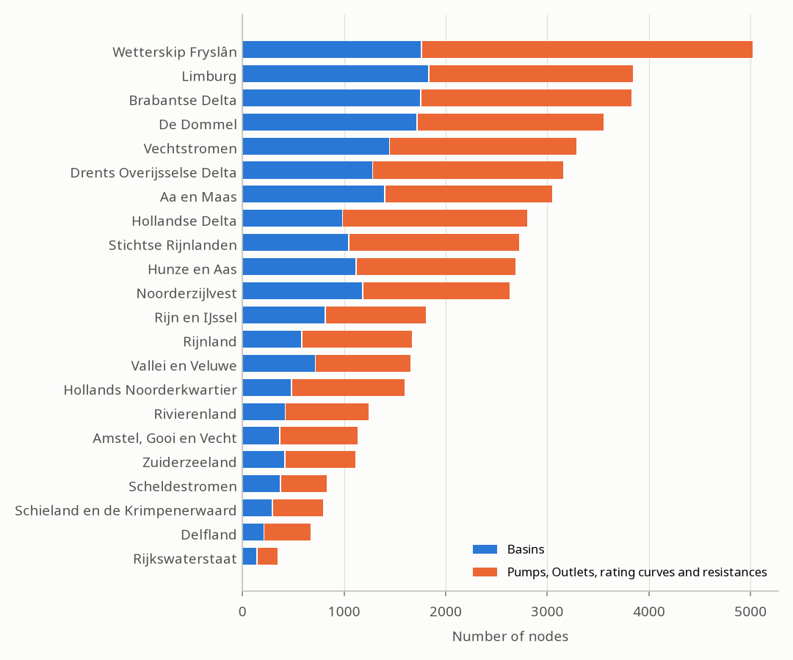

The nationwide model is made of the models of 22 authorities.
The pages below are concise descriptions of the regional Ribasim models of the gravity controlled water authorities, in Dutch: how the water system works, with its main structures and capacities.
[Model derivation](../workflow/index.qmd) says how it is schematized.
The level controlled water authorities have no description yet.

Each link opens the part of the [model viewer](../viewer.qmd) with the model of that authority.

{fig-alt="Bar chart of Basins and connector nodes per authority, with the most in Rijnland, Stichtse Rijnlanden and Hollands Noorderkwartier."}

| Authority | Kind of model | Description | Model viewer |
|:----------|:--------------|:------------|:-------------|
| Rijkswaterstaat | [Main water system](../workflow/main-watersystem.qmd) | | [80](../viewer.qmd#authority=80) |
| Aa en Maas | [Gravity controlled](../workflow/gravity-controlled.qmd) | [Beschrijving](AaenMaas.qmd) | [38](../viewer.qmd#authority=38) |
| Brabantse Delta | Gravity controlled | [Beschrijving](BrabantseDelta.qmd) | [25](../viewer.qmd#authority=25) |
| De Dommel | Gravity controlled | [Beschrijving](DeDommel.qmd) | [27](../viewer.qmd#authority=27) |
| Drents Overijsselse Delta | Gravity controlled | [Beschrijving](DrentsOverijsselseDelta.qmd) | [59](../viewer.qmd#authority=59) |
| Hunze en Aas | Gravity controlled | [Beschrijving](HunzeenAas.qmd) | [33](../viewer.qmd#authority=33) |
| Limburg | Gravity controlled | [Beschrijving](Limburg.qmd) | [60](../viewer.qmd#authority=60) |
| Noorderzijlvest | Gravity controlled | [Beschrijving](Noorderzijlvest.qmd) | [34](../viewer.qmd#authority=34) |
| Rijn en IJssel | Gravity controlled | [Beschrijving](RijnenIJssel.qmd) | [7](../viewer.qmd#authority=7) |
| Stichtse Rijnlanden | Gravity controlled | [Beschrijving](StichtseRijnlanden.qmd) | [14](../viewer.qmd#authority=14) |
| Vallei en Veluwe | Gravity controlled | [Beschrijving](ValleienVeluwe.qmd) | [43](../viewer.qmd#authority=43) |
| Vechtstromen | Gravity controlled | [Beschrijving](Vechtstromen.qmd) | [44](../viewer.qmd#authority=44) |
| Amstel, Gooi en Vecht | [Level controlled](../workflow/level-controlled.qmd) | | [11](../viewer.qmd#authority=11) |
| Delfland | Level controlled | | [15](../viewer.qmd#authority=15) |
| Hollands Noorderkwartier | Level controlled | | [12](../viewer.qmd#authority=12) |
| Hollandse Delta | Level controlled | | [40](../viewer.qmd#authority=40) |
| Rijnland | Level controlled | | [13](../viewer.qmd#authority=13) |
| Rivierenland | Level controlled | | [9](../viewer.qmd#authority=9) |
| Scheldestromen | Level controlled | | [42](../viewer.qmd#authority=42) |
| Schieland en de Krimpenerwaard | Level controlled | | [39](../viewer.qmd#authority=39) |
| Wetterskip Fryslân | Level controlled | | [2](../viewer.qmd#authority=2) |
| Zuiderzeeland | Level controlled | | [37](../viewer.qmd#authority=37) |
