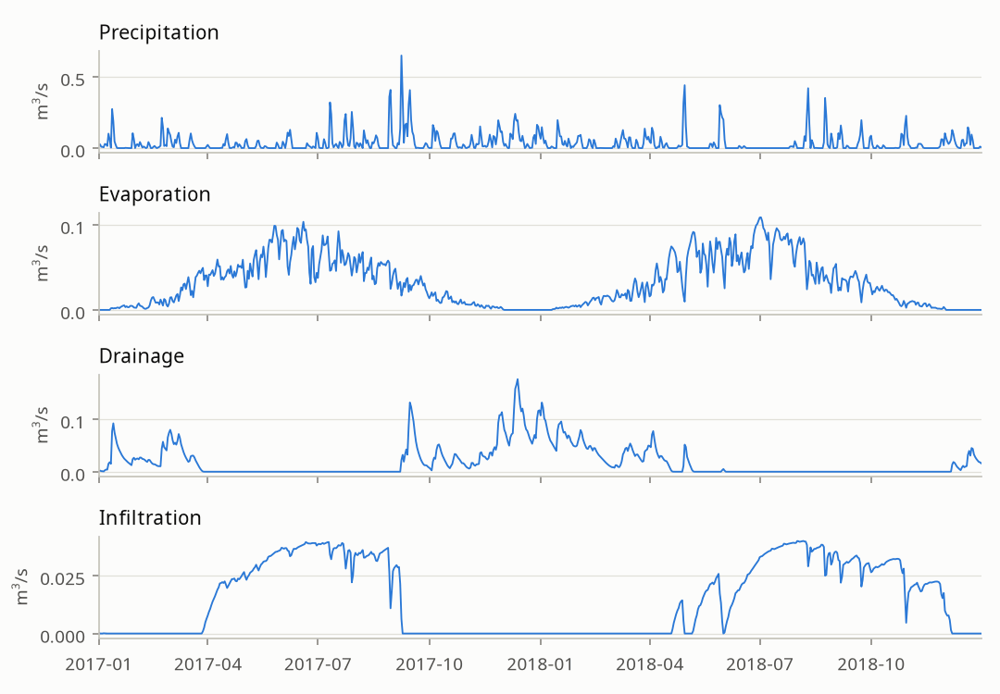

The regional models and the main water system share their forcing, in `ribasim_nl.regional_model`, for 2017 up to 2020.
The run of the coupled model covers the first 2 of these 3 years.

```{mermaid}
flowchart LR
  lhm["LHM 4.3 results<br>LHM_433_budgets_update_makkink"] --> meteo["Precipitation,<br>evaporation"]
  lhm --> budgets["Drainage, infiltration,<br>surface runoff, sprinkling"]
  meteo --> basin["Basin / time"]
  budgets --> basin
  foreign["Measured foreign inflows<br>BuitenlandseAanvoer"] --> flow["FlowBoundary / time"]
  rwzi["RWZI model<br>Z-info, RwziBase"] --> flow
  flow --> model["Regional model"]
  basin --> model
  model --> fractions["LHM fractions<br>for tracing water"]
```

{fig-alt="Four charts over 2017 and 2018: precipitation with sharp peaks, evaporation peaking in summer, drainage in winter, and infiltration in summer."}

## Precipitation and evaporation

Both come from the results of LHM 4.3, averaged per Basin, see `ribasim_nl.set_forcing`.
Evaporation is the Makkink reference evaporation times the open water factor of Mozart, by month and decade.
An LHM day starts at 09:00 in model time, so the forcing starts on the day before the start of the model.

## Drainage, infiltration and runoff {#sec-budgets}

`ribasim_nl.assign_offline_budgets` adds the MODFLOW-MetaSWAP budgets of the LHM, summed per Basin: negative values become drainage, and positive values infiltration.

| Budget | Goes to |
|:-------|:--------|
| `bdgriv_sys1`, `4`, `5` | doorgaand and hoofdwater Basins |
| `bdgriv_sys2`, `3`, `6`, `bdgdrn_sys1`, `2`, `3` | bergend Basins |
| `bdgqrun` | `surface_runoff` |
| `bdgpssw`, sprinkling | hoofdwater and doorgaand Basins in the gravity controlled models, bergend Basins in the level controlled models |

The script writes the budgets to `mfms_budgets.arrow`, and a check of the assignment to `results/assign_validation.png` in the model folder.

## Foreign inflows

Streams from Germany and Belgium enter as FlowBoundaries with `meta_categorie` "buitenlandse aanvoer".
`src/ribasim_nl/ribasim_nl/data/buitenlandse_aanvoer.csv` lists the 55 inflows, all in Brabantse Delta, De Dommel, Limburg, Rijn en IJssel and Vechtstromen.
`ribasim_nl.transboundary_inflow` matches them to the boundaries by name and location, and sets measured daily values from `Basisgegevens/BuitenlandseAanvoer`, with gaps interpolated.
Outside the measurements, or without any, the inflow is the constant in that table.

## Wastewater {#sec-rwzi}

The stage `rwzi` makes a separate model with `pipeline/create_rwzi_model.py`, of one FlowBoundary per treatment plant, linked to a Terminal at its discharge point.
The flow rates are daily influent from Z-info, or else the yearly values of RwziBase, spread evenly over the days.

```{mermaid}
flowchart LR
  a["RWZI FlowBoundary"] --> b["Junction, was the Terminal"]
  b --> c["Route into or<br>out of the Basin"]
```

`merge_rwzi_model` adds the plants that discharge in the model, within 100 m of a Basin that is not bergend, or 3000 m in the main water system, and removes the others.
`attach_rwzi_junctions` then moves each Junction onto the nearest route into or out of its Basin.

## Fractions

`ribasim_nl.assign_lhm_fractions` labels the water by its origin, such as precipitation, drainage, or the neighbouring authority.
The model then tracks these fractions through the network, and `ribasim_nl.delwaq` can use them for water quality with Delwaq.
